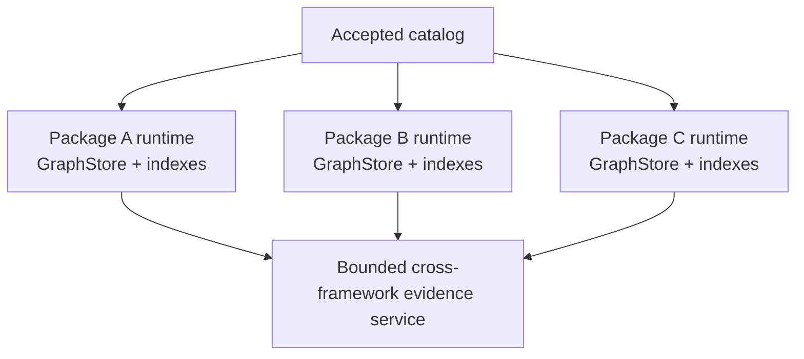

# Graph package format

A graph package is the immutable delivery unit the MCP server validates, indexes, and
serves. Each package belongs to one framework family and one exact snapshot.

The runtime consumes packages; it does not construct curriculum graphs from source PDFs
or other source documents during MCP startup.

## Directory identity

Packages are discovered under:

```text
data/graph_packages/<framework-id>/<snapshot-id>/
```

The snapshot directory must be under the matching framework directory, and both names
must satisfy the repository identifier contracts.

A package holds only the files the server needs at runtime:

```text
<snapshot-id>/
├── package_manifest.json
├── delivery/
│   ├── as_lc_lp_nodes_*.jsonl
│   └── as_lc_lp_relationships_*.jsonl
├── detailed/
│   ├── as_lc_validation_report.json
│   ├── as_standards_framework.json
│   ├── as_unresolved_items.json
│   ├── lc_dedup_groups.json
│   ├── lc_generation_summary.json
│   ├── lp_generation_summary.json
│   ├── lp_normalization_receipt.json
│   ├── lp_unresolved_items.json
│   └── lp_validation_report.json
├── slim/
│   ├── as_entity_provenance.json
│   ├── lc_entity_provenance.json
│   ├── lp_relationship_provenance_index.json
│   └── lp_relationship_provenance_shard_00.json … shard_63.json
└── evidence/
    └── evidence_archive_record.json
```

Artifact basenames differ by framework, but logical roles are declared by the manifest.
The six current packages range from 5.2 MB (Nigeria) to 32.3 MB (CBSE), about 84 MB in
total.

## What each area holds

| Area                    | Runtime role                                                                                                   |
|-------------------------|----------------------------------------------------------------------------------------------------------------|
| `delivery/`             | Graph records decoded into the package-local graph store and search index                                      |
| `detailed/`             | Small validation, unresolved-evidence, summary and receipt files, copied byte for byte from the build inputs   |
| `slim/`                 | Provenance served per request, derived from the full evidence by removing bulky fields (see below)             |
| `evidence/`             | The evidence archive record, which binds the full evidence by path, size and SHA-256                           |
| `package_manifest.json` | Identity, checksums, counts, capabilities, profile binding, rights, and validation state                       |

The server's primary graph runtime is built from the manifest-declared `nodes` and
`relationships` delivery artifacts.

## Runtime files and archived evidence

Each package is built from a larger set of full evidence. The package keeps what the
server reads; everything else stays outside the package and outside Git:

| Set                     | Files                                                                                                                                                                                                                                                                         | Where it lives                                                                  |
|-------------------------|-------------------------------------------------------------------------------------------------------------------------------------------------------------------------------------------------------------------------------------------------------------------------------|---------------------------------------------------------------------------------|
| Runtime (in the package) | Delivery nodes and relationships, the small `detailed/` files above, slim provenance, the evidence archive record                                                                                                                                                             | `data/graph_packages/`, committed                                               |
| Archive-only            | LP final claims, the original LP provenance map, its original index and 64 original shards, the `buildsTowards` and `relatesTo` JSONL files, the AS and AS-LC KG bundles, full AS and LC entity provenance, hierarchy relationships (`hasChild` JSONL) and standards framework items | `data/input_artifacts/<set>/`, git-ignored, with a copy in IDinsight Google Drive |

The server never reads archive-only files. Acceptance reads them to check the package
(see [Validation and lifecycle](validation.md#two-validation-tiers)). Each package's
`evidence/evidence_archive_record.json` lists every full-evidence file with:

- `packagePath`: its path in the full-evidence layout;
- `localPath`: its repository-relative location under `data/input_artifacts/<set>/`;
- `sizeBytes` and `sha256`; and
- `runtime`: `true` when the package carries the same file byte for byte, `false` when it
  is archive-only.

The record also names the archive location (`IDinsight Google Drive`). It holds no links,
absolute paths or credentials, and no tool contacts Drive. Because the record is a
declared package file, the snapshot ID commits to the archived evidence as well.

See [Add or update a framework](../development/framework-package.md#restore-and-verify-archived-evidence)
for restoring and checking the archive.

## Slim provenance

Slim files are the original records minus a few bulky fields, plus a SHA-256 that links
each record back to its archived original. Every other field is kept as is.

| Slim file                                                          | Removed from each record                                                                                  | Link to the original                                                                             |
|--------------------------------------------------------------------|-----------------------------------------------------------------------------------------------------------|--------------------------------------------------------------------------------------------------|
| `lp_relationship_provenance_shard_NN.json` (one record per LP edge) | `claim.candidate.evidence`, `claim.candidate.admissible_decisions`, `claim.provenance.producer_judgment` | `original_entry_sha256` per record; the index holds the original map's and original index's SHA-256 |
| `as_entity_provenance.json` (one item per standard)                | `candidate_source_refs`                                                                                   | `original_item_sha256` per item; `originalSha256` for the archived file                         |
| `lc_entity_provenance.json` (one record per learning component)    | Nothing                                                                                                   | `original_component_sha256` per record; `originalSha256` for the archived file                  |

The slim AS file also keeps the original `framework` object as `sourceDocument` and
drops the `kg_run_manifest` and `relationships_has_child` sections. The slim LC file
keeps the source `doc_key` and `pdf_name` as `sourceDocument`.

The slim LP index (`formatVersion` `2.0`) lists the removed fields and binds each of the
64 shards by path, entry count and SHA-256. A shard is chosen by
`SHA256(UTF8(relationship_id))[0] modulo 64`, so one edge is read from one small shard.
The largest current shard is about 0.5 MB.

All slim and record files use canonical JSON: sorted keys, compact separators, UTF-8
and one trailing newline. Building the same inputs twice gives the same bytes.

## Delivery JSONL envelope

Delivery schema version `1.2` uses one JSON object per physical line.

A node record has this outer shape:

```json
{
  "identifier": "b8436bd2-daea-5d82-acd6-850e6d00bcf2",
  "labels": ["StandardsFrameworkItem"],
  "properties": {
    "caseIdentifierUUID": "b8436bd2-daea-5d82-acd6-850e6d00bcf2",
    "description": "Explore using certain culturally acceptable language for communication",
    "gradeLevel": "[\"3\"]",
    "isCurrent": "true",
    "statementCode": "B3.1.6.1",
    "statementType": "Content Standard"
  },
  "type": "node"
}
```

A relationship record contains source and target outer node IDs plus source-facing
relationship properties:

```json
{
  "identifier": "28b84369-c0bc-57d9-b87a-7802f4c49b53",
  "label": "hasChild",
  "properties": {
    "relationshipType": "hasChild",
    "sourceEntityKey": "caseIdentifierUUID",
    "targetEntityKey": "caseIdentifierUUID"
  },
  "source_identifier": "3af5ee9c-2fd2-502b-beb0-8ee969d57556",
  "source_labels": ["StandardsFrameworkItem"],
  "target_identifier": "0017af07-7b1b-56ec-91cd-36916e5ee0a4",
  "target_labels": ["StandardsFrameworkItem"],
  "type": "relationship"
}
```

## String-valued wire properties

The external delivery `properties` object deliberately preserves source values as
strings. The decoder is the boundary that interprets a small set of known encodings.

For schema `1.2`:

- booleans are decoded only from the exact strings `"true"` and `"false"`;
- array-valued properties such as `gradeLevel` and `tags` are JSON arrays encoded inside
  a string;
- properties the schema does not define are dropped; a decoded node carries typed fields
  only, and the delivery artifact remains available byte-exact as a `raw_source`
  resource with its own checksum; and
- malformed encodings fail with typed parsing/decoding findings instead of being
  coerced loosely.

Decoded records do not carry a copy of their source property strings. Every value a
consumer needs is exposed as a typed field, and the source bytes are served by the
resource layer rather than duplicated onto every node and relationship.

The decoder does not repair identifiers, resolve endpoints, or validate graph topology;
those are later validation stages.

## Node labels

Delivery schema `1.2` recognizes these Learning Commons-shaped labels:

```text
StandardsFramework
StandardsFrameworkItem
LearningComponent
```

Every node must carry exactly one of these labels. A record matching none of them, or
more than one, is rejected at decode.

The package must contain the expected framework root and item records required by the
manifest counts and semantic validators.

## Learning components

A learning component is model-generated content decomposed from a standards framework
item. It is kept separate from standards at every level: its own node type, its own
package collection, and its own manifest counts. Standards results, hierarchy traversal,
search indexes, and framework statistics are all built from item nodes and therefore
never include generated content.

A learning component carries no CASE identifier, no grade level, and no statement
taxonomy. Those belong to published standards and are recovered by following the
component's `supports` relationships to the standards items it was decomposed from.

Delivery artifacts carry standards and learning components together, and take the
`as_lc_lp_` filename prefix:

```text
delivery/as_lc_lp_nodes_<subject>.jsonl
delivery/as_lc_lp_relationships_<subject>.jsonl
detailed/as_lc_validation_report.json
```

## Relationship representation

The current hierarchy relationship type is `hasChild`. Delivery schema `1.2` retains
`supports`, which runs from a learning component to the standards framework item it was
decomposed from, and carries a `supportConfidence` between zero and one.

Relationships retain both outer node identifiers and source-facing endpoint metadata.
The validator checks that these representations agree and that endpoints resolve
correctly.

Endpoints are referenced by different properties depending on the node they point at. A
standards framework or framework item endpoint is referenced by `caseIdentifierUUID`; a
learning component endpoint is referenced by `identifier`, because a learning component
has no CASE identity to cite. A `supports` relationship is therefore asymmetric,
referencing its source by `identifier` and its target by `caseIdentifierUUID`.

Two rules keep generated content out of source-asserted structure: a `supports`
relationship must run from a learning component to a standards framework item, and a
learning component must never appear in the `hasChild` hierarchy in either direction.
Every learning component must be reachable by at least one `supports` relationship.

A relationship can also carry a supported unresolved status such as
`unresolvedRootFallback`. Such evidence remains explicitly unresolved rather than being
silently repaired.

## Stored learning progression relationships

Delivery schema `1.2` also accepts `buildsTowards` and `relatesTo` between standard items. Both endpoints preserve CASE identity. Builds is directional support for success; relates is nonsequential conceptual/skill relatedness, stored once in canonical CASE order. Their generated author/provider/attribution is validated against LP evidence independently of hierarchy authorship. Full judgments (rationale, confidence and warnings) stay in the per-edge slim provenance, and query tools use validated projections of them, rather than being flattened into wire string properties.

Each mixed package declares `academic_standards`, `learning_components` and `learning_progressions` in `includedGraphTypes`, with primary `graphType: academic_standards`. It has one GraphStore/runtime; label-specific operations keep hasChild ancestry, LC supports and LP separate. LP creates no new node kind. See [LP input/update process](../development/framework-package.md#learning-progression-inputs-and-updates).

## Closed package tree

The package tree is exact, not an open directory of auxiliary files.

The loader computes the expected file set as:

```text
package_manifest.json
+ every artifact path declared by the manifest
```

It then rejects:

- missing declared files;
- undeclared files;
- undeclared directories;
- unsafe/symlinked entries;
- artifact paths escaping the package root; and
- case-insensitive name collisions in repository/package discovery.

This means adding a file to an accepted package without declaring it in the manifest is
a validation change, not a harmless sidecar operation.

## Package-local isolation

Each accepted package gets its own graph runtime and search indexes. Framework graphs
are not merged into a single source graph.



Cross-framework tools can retrieve evidence from multiple package-local runtimes, but
they do not create cross-framework source edges or mutate any package.

## Immutability

Terminal accepted packages are treated as immutable inputs. Catalog startup revalidates
a terminal `passed` package read-only. If its bytes, tree, profile binding, or semantics
no longer validate, catalog publication fails rather than accepting the modified
content under the old identity.

See [Validation and lifecycle](validation.md) for the complete acceptance flow.

---

**Next:** [Manifest contract](manifest.md)
